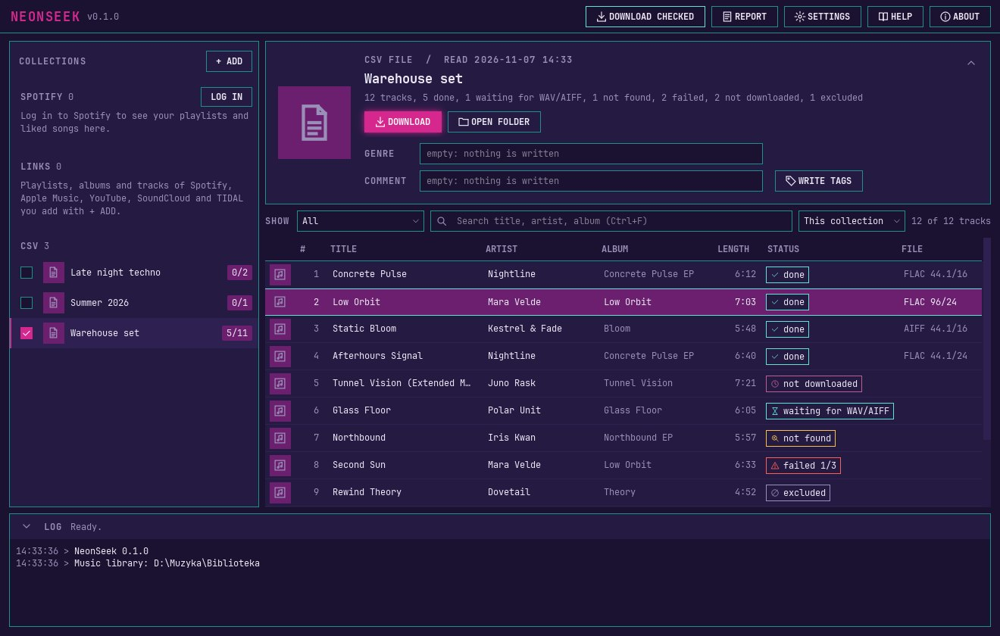

# NeonSeek

**English** | [Polski](README.pl.md)

NeonSeek is a library manager for DJs on Windows. It takes your track lists from Spotify (your playlists, your Liked Songs, or a pasted link), from links to Apple Music, YouTube, SoundCloud or TIDAL, or from a CSV file, looks for each track on the Soulseek network and downloads it in lossless quality into one music library: FLAC first, and when there is no FLAC, AIFF or WAV, or nothing, as you choose in the settings. It writes the tags and the cover into each file so that rekordbox can read them, and makes a playlist file for rekordbox for every list.



- Sources: your Spotify account, a pasted Spotify link (playlist, album or track), a link to an Apple Music album, playlist or song, a YouTube playlist or video, a SoundCloud set or track, a TIDAL playlist, album or track, or a CSV file (also the .txt export of iTunes). Only the track lists come from these services, the audio always comes from Soulseek. From YouTube and SoundCloud the artist and title are guessed from the upload titles, so fewer tracks are found. Spotify is optional.
- Lossless only. A lossy file never goes into the library, whatever its file extension says.
- One file per track, with no duplicates between lists, plus an `.m3u8` playlist for each list.
- Incremental: the next run downloads only the new tracks. A report shows what was not found or failed, and you can retry from there.
- Tags from the source (title, artists, album, release date, track and disc number, ISRC) plus a genre and a comment you set for each list, written so that rekordbox shows them.
- The window and the command line are in English and Polish. Six color themes.

## Requirements

- Windows 10 or 11, 64-bit.
- A Soulseek account. NeonSeek can create one for you in the setup wizard, or you can use your own. A separate account just for NeonSeek is recommended.
- A music library folder on an internal drive.
- For Spotify sources only: a Spotify account with **Premium** and your own Spotify developer app (see below). Without Spotify, use CSV files.

## Installation

The installer (`NeonSeek-Setup-<version>.exe`) and a portable version are attached to each release on the [Releases page](../../releases). Download the installer, run it and start NeonSeek from the Start menu. It installs for your Windows user only and does not ask for an administrator password. The installer is not digitally signed, so Windows SmartScreen may warn you the first time you run it: click **More info**, then **Run anyway**. On Windows 11 with Smart App Control turned on, unsigned programs are blocked without that button. Details are in the manual, chapter "Installing, updating and uninstalling".

Uninstalling (Windows **Settings > Apps**) removes only the program. Your data in `%APPDATA%\NeonSeek` and your music library stay.

On the first start a short wizard asks for the language, your Soulseek account, the library folder, Spotify (optional) and a color theme.

### Running from source

You need [uv](https://docs.astral.sh/uv/) and PowerShell. uv installs the right Python version by itself.

```powershell
uv sync
powershell -ExecutionPolicy Bypass -File scripts\fetch_sockseek.ps1   # downloads the pinned Sockseek release
uv run neonseek-gui                                                  # the window
uv run neonseek --help                                               # the command line
uv run pytest                                                        # the tests, offline
```

## Your Soulseek account

Every user needs their own Soulseek account. In the wizard choose **Create a new account** and type only the name you want: NeonSeek makes a long password, keeps it in Windows Credential Manager and the first login creates the account. Or choose **Use my own account** and type the name and password of an account you have. A separate account just for NeonSeek is recommended.

## Your own Spotify Client ID

NeonSeek has no shared Spotify app built in. Every user creates their own developer app and gives NeonSeek its Client ID. The wizard and the Settings walk you through it:

1. Open the [Spotify Developer Dashboard](https://developer.spotify.com/dashboard) (the **OPEN DASHBOARD** button in NeonSeek) and log in.
2. Create an app. In **Redirect URIs** add exactly `http://127.0.0.1:43821/callback` (`127.0.0.1`, not `localhost`). Tick **Web API**.
3. Copy the app's **Client ID** into NeonSeek and press **LOG IN TO SPOTIFY**. You do not need the Client Secret.

Spotify requires Premium on the account that owns the developer app. New developer apps cannot read the tracks of other people's playlists or of playlists made by Spotify. Copy such tracks into your own playlist, or use a CSV file. Your Soulseek password and your Spotify login are kept in Windows Credential Manager, never in a file.

## CSV files

The first row names the columns, only a title column is required. NeonSeek recognizes the usual names (`Artist`, `Title`, `Album`, `Length`, `ISRC`, a Spotify URI or ID), finds the separator (comma, semicolon or tab) by itself, and reads lengths as `3:45`, seconds or milliseconds. Without a length column, tracks are downloaded without checking their length. Columns with other names can be chosen in the import window. Example:

```
Artist;Title;Album;Length
Nightline;Concrete Pulse;Concrete Pulse EP;6:12
```

## Manual

The full user manual, in English and Polish, is built into NeonSeek (the **HELP** button) and comes as a PDF:

- PDF: attached to each release on the [Releases page](../../releases) and installed with NeonSeek. From source, `uv run python scripts/build_manual.py` builds both PDFs into `docs/manual/pdf/`.
- Online: [English](docs/manual/en.md), [Polski](docs/manual/pl.md).

Two things worth knowing before you start: rekordbox does not show the cover or the track number of WAV files, and after you change the tags of a list you need **Reload Tag** in rekordbox to see them.

## Disclaimer

- **NeonSeek does not host or share any files.** You alone are responsible for what you download and for respecting copyright. Many tracks on Soulseek are protected by copyright. Whether you may download a track depends on the law of your country and on the track. Download only what you have the right to download.
- **You are responsible for following the rules of Soulseek and Spotify.** The Soulseek server rules forbid automated clients and scripts, and NeonSeek searches and downloads automatically, so using it can break these rules and the server operators can ban your account. NeonSeek keeps to the default search limit and never shares or uploads files, but it cannot make automated use allowed. Spotify access goes through your own developer app and Spotify's terms for it.
- NeonSeek is not affiliated with, endorsed by or sponsored by Spotify, Soulseek or AlphaTheta (rekordbox). All trademarks belong to their owners.
- NeonSeek comes without any warranty. You use it at your own risk.

## Support

NeonSeek is free. If it is useful to you, you can support its development with a voluntary donation on [Buy Me a Coffee](https://buymeacoffee.com/neonseek). The **ABOUT** window links there too.

## License

NeonSeek is free software: you can redistribute it and modify it under the terms of the GNU General Public License as published by the Free Software Foundation, either version 3 of the License, or (at your option) any later version (GPL-3.0-or-later). The full text is in [LICENSE](LICENSE).

The source code of every release is in this repository, under the tag `v<version>` (for example `v0.1.0`). The About window, the installer and `README.txt` in the installed program give the address.

NeonSeek runs [Sockseek](https://github.com/fiso64/sockseek) (AGPL-3.0) as a separate program and contains none of its code. The licenses of all parts are listed in [THIRD_PARTY_LICENSES](THIRD_PARTY_LICENSES).
