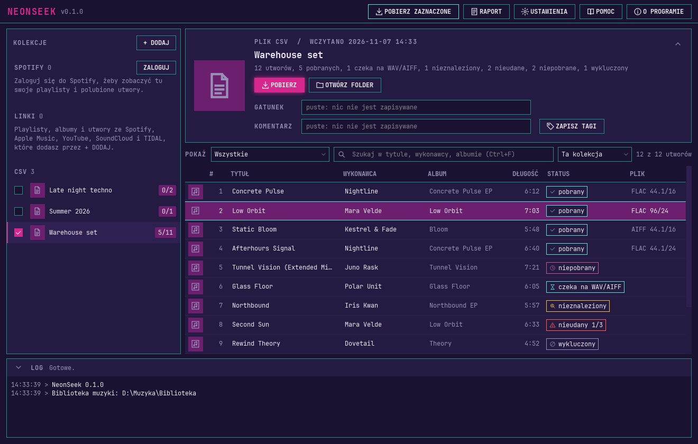

# NeonSeek

[English](README.md) | **Polski**

NeonSeek to menedżer biblioteki dla DJ-ów na Windows. Bierze Twoje listy utworów ze Spotify (Twoje playlisty, Polubione utwory albo wklejony link), z linków Apple Music, YouTube, SoundCloud albo TIDAL albo z pliku CSV, szuka każdego utworu w sieci Soulseek i pobiera go w jakości bezstratnej do jednej biblioteki muzyki: najpierw FLAC, a gdy go nie ma, AIFF albo WAV albo nic, zależnie od ustawień. W każdym pliku zapisuje tagi i okładkę tak, żeby czytał je rekordbox, a dla każdej listy tworzy playlistę dla rekordboxa.



- Źródła: konto Spotify, wklejony link Spotify (playlista, album albo utwór), link do albumu, playlisty albo utworu Apple Music, playlisty albo filmu YouTube, setu albo utworu SoundCloud, playlisty, albumu albo utworu TIDAL, albo plik CSV (także eksport .txt z iTunes). Z tych serwisów brana jest tylko lista utworów, dźwięk zawsze pochodzi z Soulseeka. Przy YouTube i SoundCloud wykonawca i tytuł są odgadywane z tytułów nagrań, więc znajdzie się mniej utworów. Spotify nie jest wymagane.
- Tylko formaty bezstratne. Plik stratny nigdy nie trafia do biblioteki, niezależnie od rozszerzenia.
- Jeden plik na utwór, bez duplikatów między listami, i playlista `.m3u8` dla każdej listy.
- Przyrostowo: kolejne uruchomienie pobiera tylko nowe utwory. Raport pokazuje, czego nie znaleziono albo co się nie udało, i stamtąd można ponowić.
- Tagi ze źródła (tytuł, wykonawcy, album, data wydania, numer utworu i dysku, ISRC) oraz gatunek i komentarz ustawiane dla każdej listy, zapisane tak, żeby pokazywał je rekordbox.
- Okno i wiersz poleceń po polsku i po angielsku. Sześć motywów kolorów.

## Wymagania

- Windows 10 albo 11, 64-bitowy.
- Konto Soulseek. NeonSeek może je założyć w kreatorze pierwszego uruchomienia, można też podać własne. Zalecane osobne konto tylko dla NeonSeek.
- Folder biblioteki muzyki na dysku wewnętrznym.
- Tylko dla źródeł Spotify: konto Spotify z **Premium** i własna aplikacja deweloperska Spotify (niżej). Bez Spotify zostają pliki CSV.

## Instalacja

Instalator (`NeonSeek-Setup-<wersja>.exe`) i wersja przenośna są dołączone do każdego wydania na [stronie Releases](../../releases). Pobierz instalator, uruchom go i włącz NeonSeek z menu Start. Instaluje się tylko dla Twojego użytkownika Windows i nie pyta o hasło administratora. Instalator nie jest podpisany cyfrowo, więc przy pierwszym uruchomieniu Windows SmartScreen może ostrzec: kliknij **Więcej informacji**, a potem **Uruchom mimo to**. W Windows 11 z włączonym Inteligentnym sterowaniem aplikacjami (Smart App Control) programy bez podpisu są blokowane bez tego przycisku. Szczegóły są w instrukcji, w rozdziale „Instalacja, aktualizacja i odinstalowanie”.

Odinstalowanie (Windows **Ustawienia > Aplikacje**) usuwa tylko program. Twoje dane w `%APPDATA%\NeonSeek` i biblioteka muzyki zostają.

Przy pierwszym uruchomieniu krótki kreator pyta o język, konto Soulseek, folder biblioteki, Spotify (opcjonalnie) i motyw kolorów.

### Uruchomienie z kodu źródłowego

Potrzebne są [uv](https://docs.astral.sh/uv/) i PowerShell. uv sam instaluje właściwą wersję Pythona.

```powershell
uv sync
powershell -ExecutionPolicy Bypass -File scripts\fetch_sockseek.ps1   # pobiera przypiętą wersję Sockseeka
uv run neonseek-gui                                                  # okno
uv run neonseek --help                                               # wiersz poleceń
uv run pytest                                                        # testy, bez internetu
```

## Konto Soulseek

Każdy użytkownik potrzebuje własnego konta Soulseek. W kreatorze wybierz **Załóż nowe konto** i wpisz tylko wymyśloną przez siebie nazwę: NeonSeek wygeneruje długie hasło, zapisze je w Menedżerze poświadczeń Windows, a pierwsze logowanie założy konto. Możesz też wybrać **Użyj własnego konta** i podać nazwę i hasło konta, które już masz. Zalecane jest osobne konto tylko dla NeonSeek.

## Własny Spotify Client ID

NeonSeek nie ma wbudowanej wspólnej aplikacji Spotify. Każdy zakłada własną aplikację deweloperską i podaje NeonSeek jej Client ID. Kreator i Ustawienia prowadzą przez to krok po kroku:

1. Otwórz [Spotify Developer Dashboard](https://developer.spotify.com/dashboard) (przycisk **OTWÓRZ DASHBOARD** w NeonSeek) i zaloguj się.
2. Utwórz aplikację. W polu **Redirect URIs** dodaj dokładnie `http://127.0.0.1:43821/callback` (`127.0.0.1`, nie `localhost`). Zaznacz **Web API**.
3. Skopiuj **Client ID** aplikacji do NeonSeek i naciśnij **ZALOGUJ DO SPOTIFY**. Client Secret nie jest potrzebny.

Spotify wymaga Premium na koncie, do którego należy aplikacja deweloperska. Nowe aplikacje deweloperskie nie widzą utworów z cudzych playlist ani z playlist tworzonych przez Spotify. Takie utwory skopiuj do własnej playlisty albo użyj pliku CSV. Hasło Soulseek i logowanie do Spotify są w Menedżerze poświadczeń Windows, nigdy w pliku.

## Pliki CSV

Pierwszy wiersz nazywa kolumny, wymagana jest tylko kolumna tytułu. NeonSeek rozpoznaje typowe nazwy (`Artist`, `Title`, `Album`, `Length`, `ISRC`, URI albo ID ze Spotify, a także `wykonawca` i `tytuł`), sam znajduje separator (przecinek, średnik albo tabulator) i czyta długość jako `3:45`, sekundy albo milisekundy. Bez kolumny długości utwory pobierają się bez sprawdzania długości. Kolumny o innych nazwach wskażesz w oknie importu. Przykład:

```
Artist;Title;Album;Length
Nightline;Concrete Pulse;Concrete Pulse EP;6:12
```

## Instrukcja

Pełna instrukcja obsługi, po polsku i po angielsku, jest wbudowana w NeonSeek (przycisk **POMOC**) i dostępna jako PDF:

- PDF: dołączony do każdego wydania na [stronie Releases](../../releases) i instalowany razem z NeonSeek. Z kodu źródłowego oba PDF-y buduje `uv run python scripts/build_manual.py` do `docs/manual/pdf/`.
- Online: [Polski](docs/manual/pl.md), [English](docs/manual/en.md).

Dwie rzeczy warto wiedzieć od początku: rekordbox nie pokazuje okładki ani numeru utworu w plikach WAV, a po zmianie tagów listy trzeba w rekordboxie użyć **Reload Tag**, żeby je zobaczyć.

## Zastrzeżenia

- **NeonSeek nie hostuje ani nie udostępnia żadnych plików.** Sam odpowiadasz za to, co pobierasz, i za przestrzeganie praw autorskich. Wiele utworów w sieci Soulseek jest chronionych prawem autorskim. To, czy wolno Ci pobrać dany utwór, zależy od prawa Twojego kraju i od samego utworu. Pobieraj tylko to, do czego masz prawo.
- **Odpowiadasz za przestrzeganie zasad Soulseeka i Spotify.** Zasady serwera Soulseek zakazują automatycznych klientów i skryptów, a NeonSeek wyszukuje i pobiera automatycznie, więc korzystanie z niego może łamać te zasady i operatorzy serwera mogą zablokować Twoje konto. NeonSeek trzyma się domyślnego limitu wyszukiwań i nigdy niczego nie udostępnia ani nie wysyła, ale nie sprawi, że automatyczne korzystanie stanie się dozwolone. Dostęp do Spotify idzie przez Twoją własną aplikację deweloperską i warunki Spotify, które jej dotyczą.
- NeonSeek nie jest powiązany ze Spotify, Soulseekiem ani AlphaTheta (rekordbox), nie jest przez nie wspierany ani sponsorowany. Znaki towarowe należą do ich właścicieli.
- NeonSeek nie daje żadnej gwarancji. Korzystasz z niego na własną odpowiedzialność.

## Wsparcie

NeonSeek jest darmowy. Jeśli Ci się przydaje, możesz wesprzeć jego rozwój dobrowolną wpłatą na [Buy Me a Coffee](https://buymeacoffee.com/neonseek). Link jest też w oknie **O PROGRAMIE**.

## Licencja

NeonSeek to wolne oprogramowanie: można je rozpowszechniać i zmieniać na warunkach GNU General Public License opublikowanej przez Free Software Foundation, w wersji 3 albo (według własnego wyboru) dowolnej późniejszej (GPL-3.0-or-later). Pełny tekst jest w pliku [LICENSE](LICENSE) (po angielsku, wiążąca jest tylko wersja angielska).

Kod źródłowy każdego wydania jest w tym repozytorium, pod tagiem `v<wersja>` (np. `v0.1.0`). Adres podają też okno O programie, instalator i plik `README.txt` w zainstalowanym programie.

NeonSeek uruchamia [Sockseeka](https://github.com/fiso64/sockseek) (AGPL-3.0) jako osobny program i nie zawiera żadnego jego kodu. Licencje wszystkich składników są w pliku [THIRD_PARTY_LICENSES](THIRD_PARTY_LICENSES).
