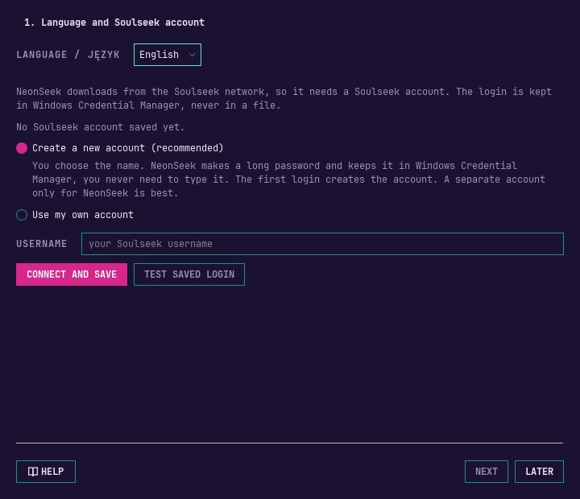
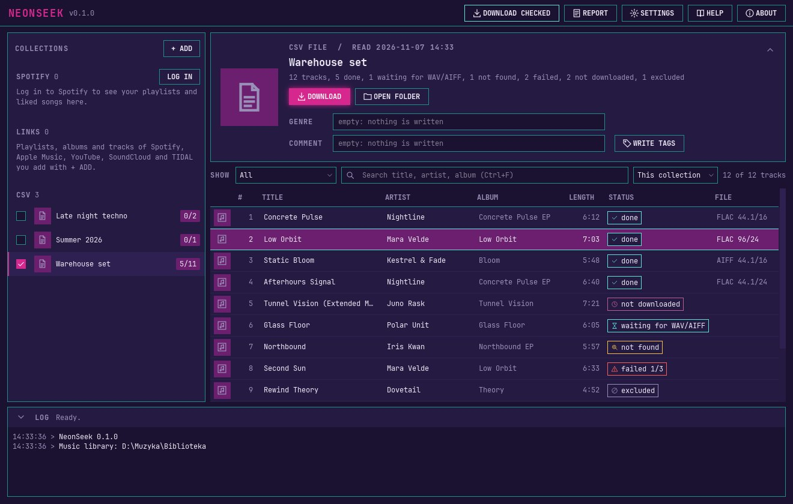
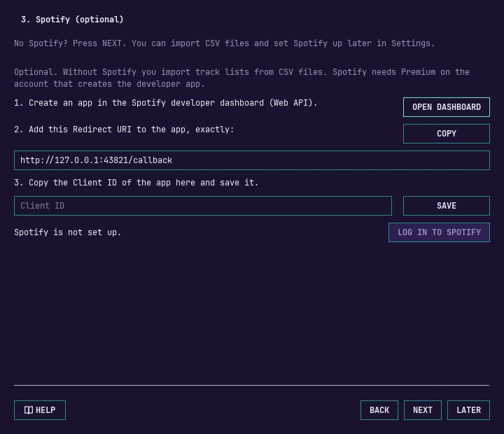
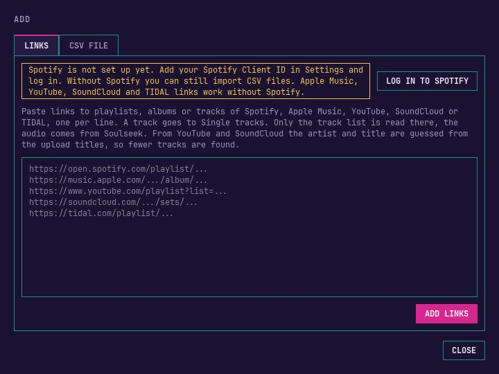
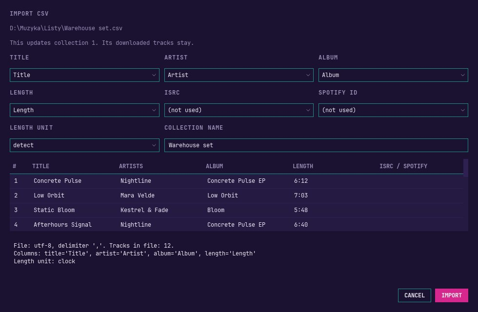
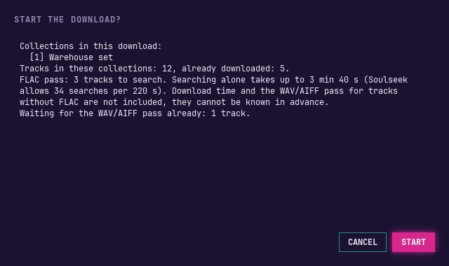
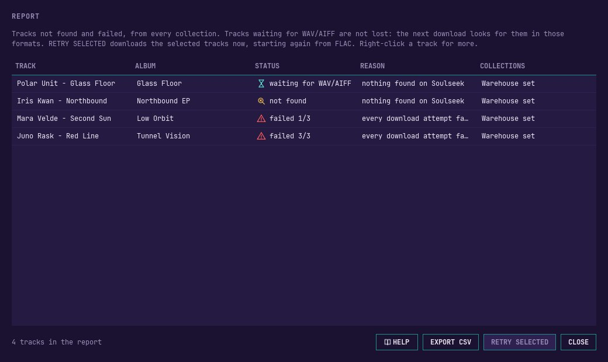
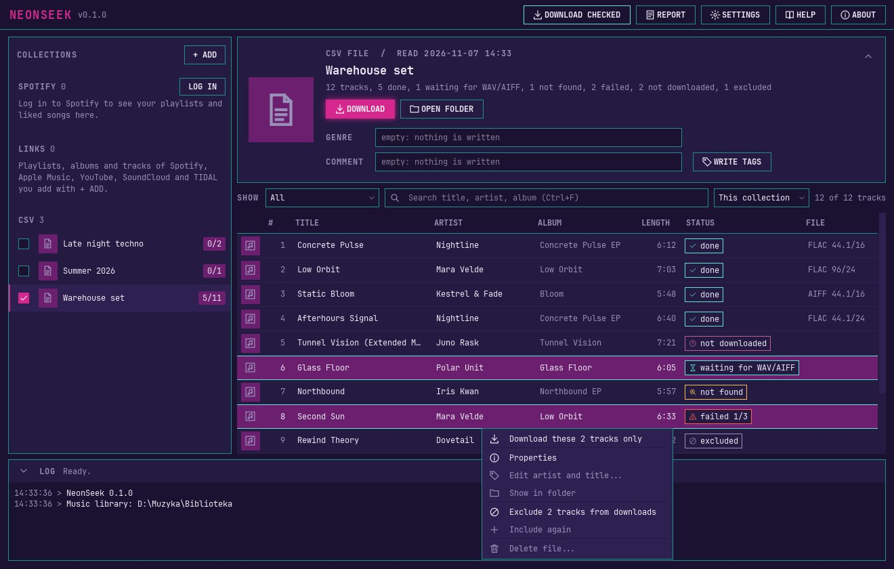
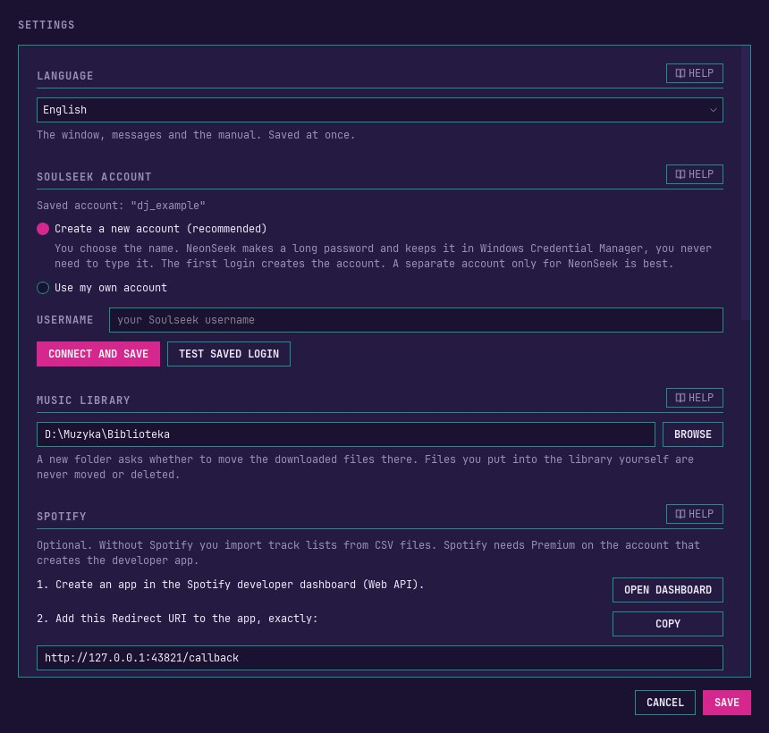

# NeonSeek user manual

NeonSeek takes your track lists, from Spotify, Apple Music, YouTube, SoundCloud, TIDAL or a CSV file, finds the tracks on the Soulseek network and downloads them in lossless quality, FLAC first. The files land in one music library folder, ready for rekordbox, with covers and tags written into them, and with a playlist file for every list.

You do not need to know anything about programming. Everything happens in the window. This manual follows the order in which you will meet things: installing, the first start, adding lists, downloading, and what to do when something goes wrong. The last chapter explains the rules of the Soulseek network. Please read it before your first download.

You can open this manual at any time with **HELP** at the top of the window. In Settings, every section has its own **HELP** button that opens the chapter about that section. The first start wizard and the report have one too.

## Installing, updating and uninstalling {#install}

### Installing {#installing}

1. Download the installer `NeonSeek-Setup-<version>.exe` from wherever you got NeonSeek.
2. Double-click it. If Windows shows a blue warning first, read the next section. NeonSeek installs for your Windows user only, so Windows does not ask for an administrator password.
3. The installer uses the language of Windows when it is English or Polish. Otherwise it first asks which language to use.
4. **License:** the first page shows the license of NeonSeek and where the source code of this version is. You do not have to accept anything: NeonSeek is free software, and the license only gives you rights. Click **Next**.
5. **Select Destination Location:** NeonSeek goes to `%LOCALAPPDATA%\Programs\NeonSeek`. Keep this folder and click **Next**.
6. **Select Additional Tasks:** tick **Create a desktop shortcut** if you want one, click **Next**, then **Install**.
7. On the last page, leave **Launch NeonSeek** ticked and click **Finish**. Later you start NeonSeek from the Start menu.

The program folder also holds the manual as PDF (folder `manual`), `LICENSE.txt`, `THIRD_PARTY_LICENSES.txt` with the licenses of all parts, and `README.txt`.

If you got the portable version (`NeonSeek-<version>-portable.zip`), unpack it into any folder and start `NeonSeek.exe` in the `NeonSeek` folder. It works the same way and keeps its data in the same place.

### The Windows SmartScreen warning {#smartscreen}

NeonSeek is not signed with a paid certificate, so when you start the installer (or `NeonSeek.exe` of the portable version) for the first time, Windows may show a blue window titled **Windows protected your PC**. This is normal for small programs from independent authors.

1. Click **More info**.
2. Check that the app is `NeonSeek-Setup-<version>.exe` (or `NeonSeek.exe`) and the publisher is "Unknown publisher", then click **Run anyway**.

Windows remembers your choice for this file. The installed program does not show the warning again.

> [!WARNING] Smart App Control on Windows 11
> When Smart App Control is on, Windows 11 blocks programs without a signature, NeonSeek too. The message says that Smart App Control blocked an app, and there is no **Run anyway** button. NeonSeek then runs only after you turn Smart App Control off in **Windows Security > App & browser control > Smart App Control settings**. That lowers the protection of your PC, so decide for yourself. On some versions of Windows it cannot be turned on again without reinstalling Windows.

### Updating {#updating}

Download the installer of the new version and run it, just like the first time. You do not need to uninstall the old version first. Close NeonSeek before, or let the installer close it when it asks. Your collections, download states, settings and logins stay. When the new version needs to change the database, it first saves a copy of it next to the original (`neonseek-schema-<number>-backup.db`), so nothing is lost if something goes wrong.

### Uninstalling {#uninstalling}

Open Windows **Settings > Apps > Installed apps** (on Windows 10 **Settings > Apps > Apps & features**), find NeonSeek and choose **Uninstall**. This removes only the program. Two things stay on purpose:

- your music library folder with all downloaded files and playlists,
- your NeonSeek data in `%APPDATA%\NeonSeek` (collections, settings, logs, cover cache).

If you install NeonSeek again later, it continues where you stopped. If you want to remove everything, delete the `%APPDATA%\NeonSeek` folder yourself, and in Windows **Credential Manager** (Windows Credentials) remove the entries with NeonSeek in their name. Your music library is yours: delete it only if you really want to.

## First start and the setup wizard {#first-start}

At the first start NeonSeek opens a short wizard. It speaks Polish when Windows is set to Polish, English otherwise. You can close it with **LATER** at any step: what you saved stays, and the wizard comes back at the next start until the Soulseek account and the library folder are set.



1. **Language and Soulseek account.** At the top you can switch the language at once. Below it you create or enter your Soulseek account (next chapter).
2. **Music library folder.** Choose a folder on an internal drive, for example `D:\Music\Library`. Downloaded tracks go to its `tracks` subfolder, playlists for rekordbox to `playlists`.
3. **Spotify (optional).** Set up your own Spotify app, or press **NEXT** and use CSV files only. You can do this later in Settings.
4. **Colors.** Pick a theme. It changes at once, so you can look before you decide.

After the wizard you see the main window: your lists on the left, the tracks of the open list on the right, and the log at the bottom.

On a small screen, for example a laptop with 1366x768 at 125% Windows scale, NeonSeek keeps at least eight tracks in view: the header of the open list shrinks to one line with its name, numbers and buttons, and the log gets lower or folds to its bar. They open again by themselves when the window gets taller. The arrow at the right of the header and the one at the left of the log bar open or fold them by hand, and what you fold by hand stays folded.



## Your Soulseek account {#soulseek}

NeonSeek downloads from the Soulseek network, so it needs a Soulseek account. Every user of NeonSeek uses their own account. Your login is kept in Windows Credential Manager, never in a file, and NeonSeek never shows the password.

You have two choices, both in the wizard and in **SETTINGS > SOULSEEK ACCOUNT**:

- **Create a new account (recommended).** Type only the name you want. NeonSeek makes a long password, keeps it for you, and the first login creates the account. The name must be at most 30 characters, plain English letters, digits and simple symbols, without a space at the beginning or end. If the name is taken, NeonSeek says so: choose another one. A separate account only for NeonSeek is best.
- **Use my own account.** Type the name and the password of an account you already have, twice. If your password is the same as your name, NeonSeek warns you, because the name appears in logs.

**CONNECT AND SAVE** logs in once to check that it works, without any search, and only then saves the login. **TEST SAVED LOGIN** checks the saved login again later.

A check takes at most 30 seconds, and the seconds count next to the buttons. If Soulseek does not answer in time, NeonSeek says what to check, and the buttons work again. In the wizard, **NEXT** turns on as soon as the account is saved.

## Spotify, step by step (optional) {#spotify}

Spotify is optional. Without it, you import track lists from CSV files (next chapters). With it, NeonSeek reads your playlists and your Liked Songs, and you can paste links to playlists, albums and tracks.

Spotify only lets programs like NeonSeek in through a "developer app" that you create yourself, for free, with your own Spotify account. Two rules from Spotify apply: the account that creates the app needs **Spotify Premium**, and every person uses their own app. NeonSeek has no shared app built in.



1. In NeonSeek, press **OPEN DASHBOARD** (in the wizard or in Settings). The Spotify Developer Dashboard opens in your browser. Log in with your Spotify account and accept the developer terms if Spotify asks.
2. Choose **Create app**. Fill in a name (for example "NeonSeek") and a short description. Any text is fine.
3. In the **Redirect URIs** field, add exactly `http://127.0.0.1:43821/callback`. Use **COPY** in NeonSeek to avoid typos. It must be `127.0.0.1`, not `localhost`.
4. Where Spotify asks which APIs you plan to use, tick **Web API**. Save the app.
5. Open the settings of your new app and copy its **Client ID** (a long string of letters and digits). You do not need the Client Secret.
6. Paste the Client ID into NeonSeek and press **SAVE**.
7. Press **LOG IN TO SPOTIFY**. Your browser asks whether NeonSeek may read your playlists and Liked Songs: choose **Agree**. The browser then says you can close the tab.

Spotify changes its dashboard from time to time, so the names of buttons may differ a little. The three things that matter are always the same: Web API, the exact Redirect URI and the Client ID.

**What Spotify does not share.** A new developer app gets the tracks of playlists you own or collaborate on, and your Liked Songs. Playlists of other people, playlists made by Spotify itself (Daily Mix, Discover Weekly, Release Radar, editorial playlists) and deleted playlists show a lock. To download one of them, copy its tracks into your own playlist in Spotify, or export it as a CSV file.

## Adding lists: Spotify and other links {#adding-lists}

Every list in NeonSeek is a **collection**. The left panel groups them:

- **SPOTIFY**: your Liked Songs and your playlists. **SYNC** on the group reads the list of your playlists. When NeonSeek starts, it refreshes this list in the background (you can turn that off in Settings).
- **LINKS**: playlists, albums and sets you added with a link (Spotify, Apple Music, YouTube, SoundCloud, TIDAL), and **Single tracks**, where links to single tracks and videos go.
- **CSV**: lists imported from CSV files.

To add a link, press **+ ADD**, paste one or more links (one per line) on the **LINKS** tab and press **ADD LINKS**. You can also copy a link and press `Ctrl+V` in the NeonSeek window. Share and tracking parts of a link (like `?si=` or `utm_`) are dropped, you do not need to remove them.



A new collection never starts ticked. A Spotify playlist shows its tracks only after you press **SYNC** in its header. Removing a collection (right-click it, **Remove from NeonSeek...**) keeps its downloaded files unless you tick the option in the question.

### Apple Music, YouTube, SoundCloud and TIDAL {#other-services}

From these services NeonSeek reads only the list of tracks. The audio always comes from Soulseek, nothing is downloaded from Apple Music, YouTube, SoundCloud or TIDAL. You need no account and no login for them, only public links:

| Service | Links NeonSeek reads |
|---|---|
| Apple Music | albums, playlists, single songs (a song link or an album link with `?i=`) |
| YouTube | playlists, single videos. A video opened from a playlist adds the whole playlist, a YouTube mix (`list=RD...`) only the video |
| SoundCloud | sets (playlists), single tracks |
| TIDAL | playlists, albums, single tracks (from `tidal.com` and `listen.tidal.com`). Mixes and artist pages cannot be added |

- **Apple Music** gives exact names: artist, title, album, track number, length, genre and cover. In the search on Soulseek NeonSeek leaves out " - EP" and " - Single" at the end of album names, the album in the tags stays as Apple writes it. An Apple Music playlist page shows **only its first 300 tracks**. NeonSeek reads those and tells you so. For a longer playlist, export it from iTunes or the Music app as a text file and import that (see [Importing a CSV file](#csv)), or split it into playlists of up to 300 tracks.
- **YouTube and SoundCloud** only have the title of an upload, like "Artist - Title (Official Video)". NeonSeek takes the artist and title from it and drops decoration like (Official Video), [4K], [FREE DL] or (Lyrics), but keeps the version (remix, edit, live). When the title has no artist, the channel or uploader is used. **Fewer of these tracks are found on Soulseek** than of Spotify or Apple Music lists, so check them before downloading. Right-click a track and choose **Edit artist and title...** to correct it, a later sync keeps your names. Entries longer than 20 minutes are usually mixes or whole sets, NeonSeek warns about them in the log, exclude them if you do not need them. Deleted and private videos are left out.
- **TIDAL** gives exact names: artist, title with its version (remix, edit, instrumental), album, length and cover. NeonSeek reads TIDAL's public player page, the same one websites embed, so only public playlists work. That page shows **at most 50 tracks** of a playlist or album and does not say how many there are. When a list has 50 tracks, NeonSeek keeps them and tells you the list may be longer. For a longer playlist, split it on TIDAL into playlists of up to 50 tracks, or export it to a CSV file (for example with a playlist transfer service) and import that (see [Importing a CSV file](#csv)). Videos in a playlist are left out, the log says how many. A later sync reads the list again, also when it was cut at 50.

**SYNC** reads these collections again too, when they are ticked. You do not need to be logged in to Spotify for that: use **SYNC** in the header of the collection or **Read again from...** in its right-click menu. Without changes nothing is saved again.

## Importing a CSV file {#csv}

A CSV file is a simple table that Excel, Google Sheets, Exportify and many other tools can save. You do not need Spotify for it.

1. Press **+ ADD**, then **CHOOSE CSV FILE**, or simply drop the file on the window. A `.txt` playlist exported from iTunes or the Music app works the same way (see below).
2. NeonSeek shows the first rows the way it understood them, which column holds what, and the unit of the length column. Change anything that looks wrong.
3. Give the collection a name and press **IMPORT**.



### The format {#csv-format}

- The first row must name the columns. Only a title column is required.
- Columns are found by their names, upper or lower case does not matter:

| Field | Column names NeonSeek recognizes |
|---|---|
| Title (required) | title, track name, track, name, song, tytuł, nazwa |
| Artist | artist, artists, artist name, artist name(s), wykonawca |
| Album | album, album name |
| Length | length, duration, time, duration (ms), track duration (ms), duration_ms, czas |
| ISRC | isrc |
| Spotify ID | track uri, spotify uri, uri, track id, spotify id |

- Separators: comma, semicolon or tab, found automatically. Encoding: UTF-8, UTF-16 (the Unicode text of iTunes), or the Windows Central European code page.
- Length: `3:45` or `1:02:10`, seconds, or milliseconds. NeonSeek guesses the unit for the whole column, and you can change it.
- Several artists in one cell are split at semicolons, or at a comma with a space. The first artist is used for searching.
- Rows without a title are skipped and counted.
- Without a length column, tracks are downloaded without checking their length, so a wrong version is more likely. These tracks are marked "length not checked".

A short example:

```
Artist;Title;Album;Length
Nightline;Concrete Pulse;Concrete Pulse EP;6:12
Mara Velde;Low Orbit;Low Orbit;7:03
```

### A playlist from iTunes or the Music app {#itunes-txt}

iTunes and the Music app can save a playlist as a text file: select the playlist, then **File > Library > Export Playlist...** and choose **Unicode Text** as the format. Import the `.txt` file like a CSV file. NeonSeek reads the columns Name, Artist, Album and Time (seconds), and the Polish names Nazwa, Wykonawca, Album and Czas. This is the way to get an Apple Music playlist longer than 300 tracks.

This format was not checked on a real export from iTunes or the Music app. If NeonSeek does not find the title column, choose the columns by hand in the import window.

When the file changes, right-click the collection and choose **Import again**. Tracks already downloaded stay downloaded. If you moved the file, choose **Import from another file...**.

## Choosing collections and downloading {#downloading}

NeonSeek downloads only what you point at. There is no "download everything" button.

- **DOWNLOAD** in the header of the open collection downloads the missing tracks of that collection only.
- **DOWNLOAD CHECKED** at the top downloads every collection whose checkbox on the left is ticked. Without a ticked box it stays grey.

Before every download a summary appears: which collections, how many tracks will be searched, and the longest time the search alone can take. Press **START** to begin, or cancel.



### How a download works {#how-downloading-works}

- **FLAC first.** NeonSeek first looks only for FLAC. Tracks without FLAC go through a second pass that looks for AIFF, then WAV. You can change that in **SETTINGS > DOWNLOADS > Without FLAC**: take WAV or AIFF, or mark the track as not found. Lossy formats like MP3 are never downloaded.
- **The right version.** NeonSeek compares the length of the file with the length from your list (3 seconds of tolerance), and checks the real format of the file, not only its name.
- **The search limit.** The Soulseek server allows about 34 searches every 220 seconds and bans accounts that search more. NeonSeek always keeps to this limit, so a long list takes time: about an hour of searching for 500 tracks. While it waits, the bottom bar shows **WAITING FOR THE SOULSEEK SEARCH LIMIT**. This is normal.
- **Cancelling.** **CANCEL** at the bottom stops the download. Finished tracks stay, the rest waits for the next download. Nothing is searched twice without a reason.
- **Where files go.** Tracks go to `tracks` in your library folder, named "Artist - Title". For every collection NeonSeek writes a playlist file (`.m3u8`) into `playlists`. Import these playlist files into rekordbox to get your lists there. **OPEN FOLDER** shows the playlist file of the open collection.

The log at the bottom tells you what happens, line by line.

## What each status means {#statuses}

Every track in the table has a status. Point at it with the mouse to see what it means and what to do next.

| Status | What it means | What to do |
|---|---|---|
| not downloaded | Not downloaded yet. | Press DOWNLOAD. |
| searching | Sockseek is looking for it on Soulseek right now. | Wait. |
| downloading 45% | The file is coming in right now. | Wait, or CANCEL at the bottom. |
| done | Downloaded and in your library. The FILE column shows the format, like FLAC 44.1/16. | Nothing. Right-click > Show in folder to see the file. |
| waiting for WAV/AIFF | No FLAC was found. This is not final: the next download looks for AIFF or WAV. | Press DOWNLOAD again. |
| not found | Found in no lossless format, also not as WAV or AIFF. | See "Common problems". You can retry later from the report. |
| failed 1/3 | Found, but the download did not work (the other user went offline, the file was wrong). The numbers are attempts so far and the limit. | The next download tries again, up to the limit in Settings. |
| excluded | You told NeonSeek not to download this track. | Right-click > Include again. |

The filter above the table (**SHOW**) shows only one group, for example "Not found or failed". The search field (`Ctrl+F`) filters by title, artist and album, in this collection or in the whole library.

## The report and retrying {#report}

**REPORT** at the top lists every track that was not found or failed, from all collections, with the reason. Tracks waiting for WAV/AIFF are listed too, but they are not lost.



- Select tracks and press **RETRY SELECTED** to download them right away, starting again from FLAC. The same summary as for a normal download comes first.
- **EXPORT CSV** saves the list, for example to look for the tracks elsewhere.
- Right-click a track for the same menu as in the main table.

The report stays open next to the main window, so you can follow the download in the log. It refreshes itself when the download ends.

## Downloading single tracks {#single-tracks}

You do not need to download a whole collection. Select one or more tracks in the table (hold `Ctrl` or `Shift` to select several), right-click and choose **Download this track only** (or **Download these tracks only**). The usual summary comes first.



For a track that was not found or failed, this starts again from FLAC. For an excluded track, it includes the track again and downloads it. For a downloaded track the item is grey.

The same menu has **Properties** (everything NeonSeek knows about the track, including where it came from on Soulseek) and **Show in folder**.

## Excluding tracks and including them again {#excluding}

Sometimes you do not want a track, for example an intro or a version you already have. Select it, right-click and choose **Exclude from downloads**. No download takes it any more, not even DOWNLOAD CHECKED, and the counter of the collection no longer counts it.

To get it back, right-click it and choose **Include again**. It returns exactly to the state it had before, so NeonSeek does not search again what it already searched.

Only tracks without a file can be excluded. For a downloaded track, use **Delete file...** (next chapter).

## Deleting files {#deleting}

NeonSeek never deletes files by itself. It deletes only when you ask, only files it put into the library itself, and only into the Windows Recycle Bin, so you can always get them back.

- **One or more tracks:** select them, right-click, **Delete file...**. NeonSeek asks first and says how many files. The files go to the Recycle Bin, the tracks become excluded (so the next download does not bring them back), and the playlist files of their collections are written again without them.
- **A whole collection:** right-click the collection, **Remove from NeonSeek...**, and tick **Also move downloaded files to the Recycle Bin**. Only files of tracks that are in no other collection go, plus the playlist file of the collection. Without the tick, all files stay.

> [!WARNING] rekordbox does not notice
> Deleting a file in NeonSeek does not remove the track from your rekordbox collection. rekordbox will show it as missing. Remove it in rekordbox yourself.

Good to know:

- On a drive without a Recycle Bin (a USB stick, a network drive) NeonSeek refuses to delete, instead of deleting for good.
- Nothing can be deleted while a download runs.

## Changing the library folder {#library-folder}

Open **SETTINGS > MUSIC LIBRARY**, press **BROWSE**, choose the new folder and press **SAVE**. If the old folder has downloaded files, NeonSeek asks:

- **MOVE FILES**: the downloaded files and playlists move to the new folder. The bottom bar shows the progress, and **CANCEL** stops after the current file. Nothing is lost when you stop: choose the same folder again to finish.
- **ONLY CHANGE THE FOLDER**: new downloads go to the new folder, old files stay where they are.

> [!WARNING] Moving to another drive
> When the new folder is on another drive, every file is copied, the copy is checked, and only then the original is deleted. This is the one case where NeonSeek deletes without the Recycle Bin, and the question says so.

Files you put into the library folder yourself are never moved. A path longer than 259 characters cannot be used, NeonSeek says which files would be affected before it starts.

rekordbox remembers the old locations of the files. After a move, import the playlist files from the new folder again, or use **Relocate** in rekordbox.

## Tags and Reload Tag in rekordbox {#tags}

NeonSeek writes tags into every downloaded file so rekordbox shows them: title, artists, album, album artist, release date, track and disc number and ISRC from Spotify or your CSV file, plus the cover when the source has one. **SETTINGS > TAGS** decides whether the source data replaces the tags of the file (the default, because uploaders tag inconsistently), only fills empty fields, or is not written.

Each collection can also have its own **GENRE** and **COMMENT**, in its header (on a small screen open the header with the arrow at its right first). They are empty at first, and an empty field writes nothing. After typing them, press **WRITE TAGS**: NeonSeek writes the tags again into the files already downloaded, without downloading anything. A track in several collections gets all their genres and comments, separated by commas.

> [!NOTE] After WRITE TAGS, use Reload Tag in rekordbox
> rekordbox does not read changed tags by itself. In rekordbox, select the tracks, right-click and choose **Reload Tag**.

### The WAV limitation {#wav-limit}

rekordbox shows no cover and track number 0 for WAV files, whatever is written in them. That is why NeonSeek prefers AIFF over WAV when there is no FLAC. FLAC and AIFF files show the cover and all tags.

## Language, themes and text size {#appearance}

All in **SETTINGS**, and all applied at once, without restart:

- **LANGUAGE**: English or Polski. The window, the messages and this manual follow it.
- **THEME**: six color themes. You can add your own as TOML files in the `themes` folder of `%APPDATA%\NeonSeek`.
- **TEXT SIZE**: 90% to 150%. Also `Ctrl` and plus, `Ctrl` and minus, `Ctrl+0` for 100%.



## Common problems {#problems}

### NeonSeek cannot connect to Soulseek {#no-connection}

The download stops with a message that NeonSeek could not connect.

1. Check your internet connection.
2. Check that no antivirus or firewall program blocks NeonSeek or Sockseek (the helper program NeonSeek uses for Soulseek).
3. Try again a bit later. The Soulseek server is sometimes full or busy.
4. If it still does not work, read the box below.

> [!WARNING] Your account may be banned
> The Soulseek server does not answer banned accounts at all, so a ban looks exactly like a missing connection. A ban for searching too much lasts 30 minutes. NeonSeek never searches faster than the server allows, but other programs on the same account count too. A permanent ban is possible when the server operators decide so (see the last chapter). Then create a new account in Settings.

### A track is not found {#not-found}

- Not every track exists on Soulseek in lossless quality. Try again some days later, people share new files all the time.
- Check the spelling in your list. With a CSV file, check that the artist and title columns are the right ones. With YouTube and SoundCloud the names are guessed from upload titles: right-click the track, choose **Edit artist and title...** and correct them. A track that was not found is then searched again.
- Letters like `Ø` or `ł` in the artist or title can hide a track: Soulseek treats them as different letters.
- A track much longer or shorter than in your list (an extended mix instead of a radio edit) is skipped on purpose. Look at the reason in the report.
- If you chose "mark as not found" for tracks without FLAC, WAV and AIFF are not tried.

### Other problems {#other-problems}

- **A Spotify playlist has a lock:** Spotify does not share its tracks. Copy them into your own playlist or use a CSV file.
- **Spotify login does not finish:** check that the Redirect URI in your Spotify app is exactly `http://127.0.0.1:43821/callback`.
- **"Waiting for the Soulseek search limit" for a long time:** this is the limit working. Leave NeonSeek running.
- **Something else:** open **ABOUT**, press **COPY DIAGNOSTICS** and send the text to whoever helps you. It contains versions and the end of the logs, without passwords or account names.

## Rules and your responsibility {#rules}

Please read this before you download.

> [!WARNING] The Soulseek server rules forbid automated clients and scripts
> NeonSeek searches and downloads automatically through Sockseek, so using it can break these rules. The server operators can ban accounts that do it, temporarily or for good. NeonSeek keeps to the default search limit and never shares or uploads anything, but it cannot make automated use allowed.

- **You use NeonSeek at your own risk.** The authors of NeonSeek take no responsibility for bans, lost accounts or anything else that comes from using it.
- **Download only what you have the right to download.** Many tracks on Soulseek are protected by copyright. Whether you may download a track depends on the law of your country and on the track. If you are not sure, do not download it, and buy your music where you can.
- Spotify access goes through your own developer app and its terms. NeonSeek reads only your playlists and Liked Songs and never changes anything in your Spotify account.

NeonSeek is free and open source software under the GNU General Public License, version 3 or later (GPL-3.0-or-later), and comes without any warranty. NeonSeek is not affiliated with Spotify or Soulseek. It runs Sockseek (license AGPL-3.0) as a separate program and contains none of its code. The licenses of all parts are listed in **ABOUT**. **ABOUT** also links to the project page on GitHub and to Buy Me a Coffee, if you want to support NeonSeek with a voluntary donation.
