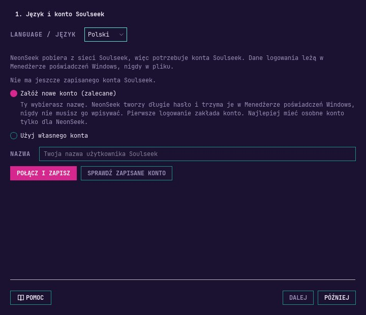
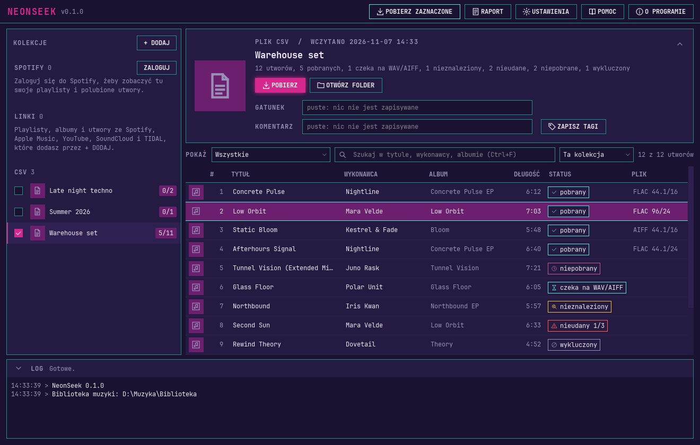
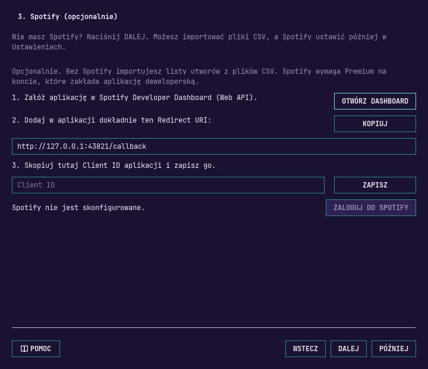
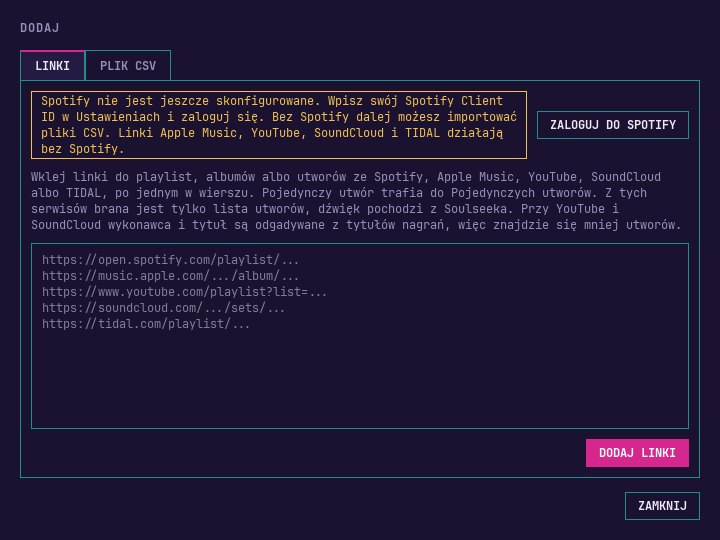
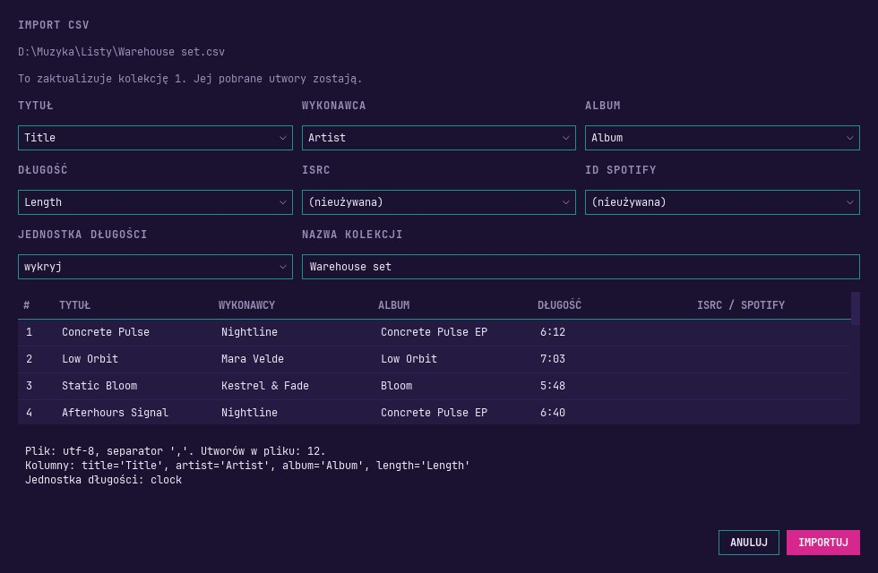
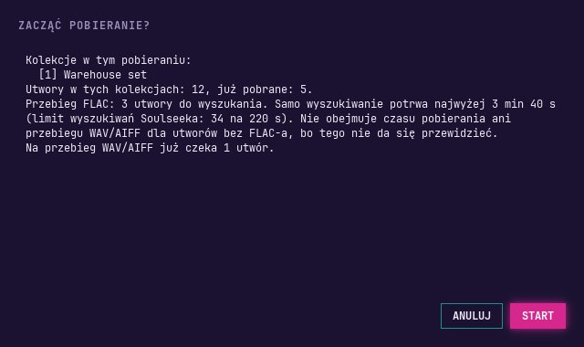
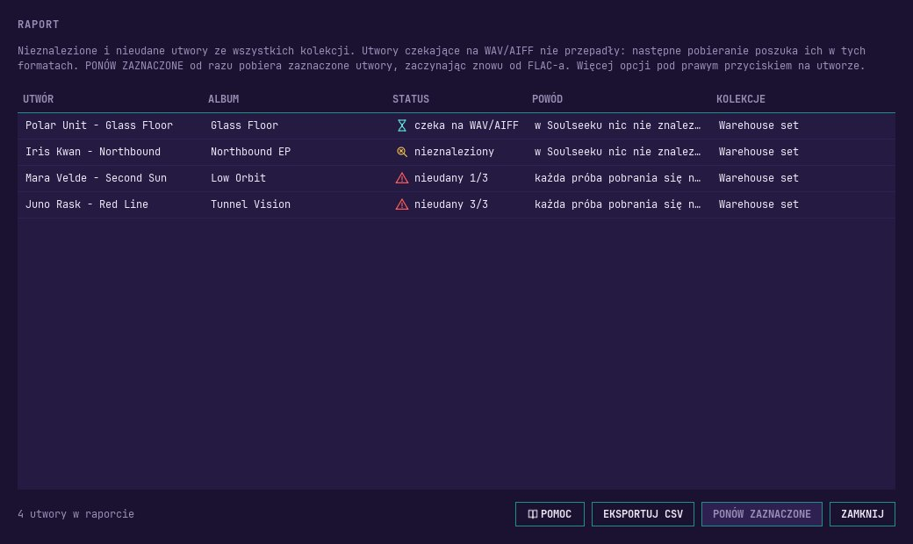
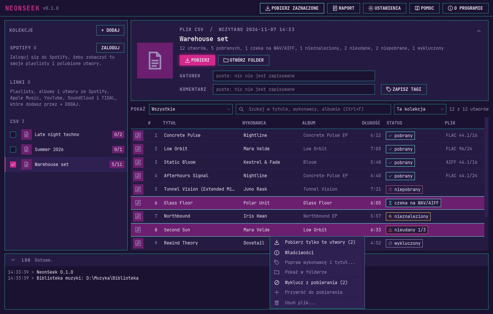
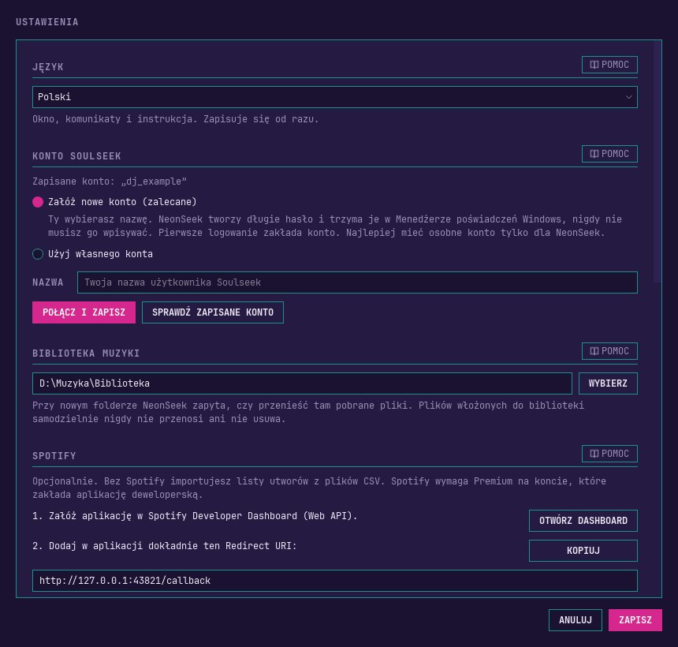

# NeonSeek: instrukcja obsługi

NeonSeek bierze Twoje listy utworów ze Spotify, Apple Music, YouTube, SoundCloud, TIDAL albo z pliku CSV, szuka tych utworów w sieci Soulseek i pobiera je w jakości bezstratnej, w pierwszej kolejności jako FLAC. Pliki trafiają do jednego folderu biblioteki muzyki, gotowe dla rekordboxa: z okładką i tagami w środku oraz z plikiem playlisty dla każdej listy.

Nie musisz znać się na programowaniu. Wszystko robisz w oknie programu. Instrukcja idzie w takiej kolejności, w jakiej będziesz poznawać program: instalacja, pierwsze uruchomienie, dodawanie list, pobieranie i co robić, gdy coś nie działa. Ostatni rozdział opisuje zasady sieci Soulseek. Przeczytaj go, zanim pobierzesz pierwszy utwór.

Instrukcję otworzysz w każdej chwili przyciskiem **POMOC** u góry okna. W Ustawieniach każda sekcja ma własny przycisk **POMOC**, który otwiera rozdział o tej sekcji. Taki przycisk mają też kreator pierwszego uruchomienia i raport.

## Instalacja, aktualizacja i odinstalowanie {#install}

### Instalacja {#installing}

1. Pobierz instalator `NeonSeek-Setup-<wersja>.exe` z miejsca, z którego masz NeonSeek.
2. Kliknij go dwukrotnie. Jeśli Windows najpierw pokaże niebieskie ostrzeżenie, przeczytaj następny podrozdział. NeonSeek instaluje się tylko dla Twojego użytkownika Windows, więc system nie pyta o hasło administratora.
3. Instalator mówi w języku Windows, gdy jest to polski albo angielski. W innym razie najpierw pyta, jakiego języka użyć.
4. **Licencja:** pierwsza strona pokazuje licencję NeonSeek i miejsce, gdzie leży kod źródłowy tej wersji. Niczego nie musisz akceptować: NeonSeek jest wolnym oprogramowaniem, a licencja daje Ci tylko prawa. Kliknij **Dalej**.
5. **Lokalizacja docelowa:** NeonSeek trafia do `%LOCALAPPDATA%\Programs\NeonSeek`. Zostaw ten folder i kliknij **Dalej**.
6. **Zadania dodatkowe:** zaznacz **Utwórz skrót na pulpicie**, jeśli go chcesz, kliknij **Dalej**, a potem **Instaluj**.
7. Na ostatniej stronie zostaw zaznaczone **Uruchom aplikację NeonSeek** i kliknij **Zakończ**. Później uruchamiasz NeonSeek z menu Start.

W folderze programu jest też instrukcja w PDF-ie (folder `manual`), `LICENSE.txt`, `THIRD_PARTY_LICENSES.txt` z licencjami wszystkich części i `README.txt`.

Jeśli masz wersję przenośną (`NeonSeek-<wersja>-portable.zip`), rozpakuj ją do dowolnego folderu i uruchom `NeonSeek.exe` w folderze `NeonSeek`. Działa tak samo i trzyma swoje dane w tym samym miejscu.

### Ostrzeżenie Windows SmartScreen {#smartscreen}

NeonSeek nie jest podpisany płatnym certyfikatem, dlatego przy pierwszym uruchomieniu instalatora (albo `NeonSeek.exe` z wersji przenośnej) Windows może pokazać niebieskie okno **System Windows ochronił ten komputer**. To normalne przy małych programach od niezależnych autorów.

1. Kliknij **Więcej informacji**.
2. Sprawdź, czy aplikacja to `NeonSeek-Setup-<wersja>.exe` (albo `NeonSeek.exe`), a wydawca to „Nieznany wydawca”, i kliknij **Uruchom mimo to**.

Windows zapamięta tę decyzję dla tego pliku. Zainstalowany program nie pokazuje już tego ostrzeżenia.

> [!WARNING] Inteligentne sterowanie aplikacjami w Windows 11
> Gdy w Windows 11 jest włączone Inteligentne sterowanie aplikacjami (Smart App Control), system blokuje programy bez podpisu, także NeonSeek. Komunikat mówi, że Inteligentne sterowanie aplikacjami zablokowało aplikację, i nie ma przycisku **Uruchom mimo to**. NeonSeek uruchomi się dopiero po wyłączeniu tej funkcji w **Zabezpieczenia Windows > Kontrolka aplikacji i przeglądarki > Ustawienia inteligentnego sterowania aplikacjami**. To zmniejsza ochronę komputera, więc zdecyduj sam. W niektórych wersjach Windows tej funkcji nie da się potem włączyć bez ponownej instalacji systemu.

### Aktualizacja {#updating}

Pobierz instalator nowej wersji i uruchom go tak jak za pierwszym razem. Nie trzeba najpierw odinstalowywać starej wersji. Zamknij wcześniej NeonSeek albo pozwól instalatorowi go zamknąć, gdy o to zapyta. Kolekcje, stan pobierania, ustawienia i dane logowania zostają. Gdy nowa wersja musi zmienić bazę danych, najpierw zapisuje jej kopię obok oryginału (`neonseek-schema-<numer>-backup.db`), więc nawet gdyby coś poszło źle, nic nie przepada.

### Odinstalowanie {#uninstalling}

Otwórz w Windows **Ustawienia > Aplikacje > Zainstalowane aplikacje** (w Windows 10 **Ustawienia > Aplikacje > Aplikacje i funkcje**), znajdź NeonSeek i wybierz **Odinstaluj**. To usuwa tylko sam program. Dwie rzeczy celowo zostają:

- folder biblioteki muzyki ze wszystkimi pobranymi plikami i playlistami,
- dane NeonSeek w `%APPDATA%\NeonSeek` (kolekcje, ustawienia, logi, pamięć podręczna okładek).

Jeśli kiedyś zainstalujesz NeonSeek ponownie, zacznie tam, gdzie skończył. Jeśli chcesz usunąć wszystko, skasuj samodzielnie folder `%APPDATA%\NeonSeek`, a w Windows otwórz **Menedżer poświadczeń** (Poświadczenia systemu Windows) i usuń wpisy, które mają w nazwie NeonSeek. Biblioteka muzyki należy do Ciebie: usuwaj ją tylko wtedy, gdy naprawdę tego chcesz.

## Pierwsze uruchomienie i kreator {#first-start}

Przy pierwszym uruchomieniu NeonSeek otwiera krótki kreator. Mówi po polsku, gdy Windows jest po polsku, a w innym wypadku po angielsku. Na każdym kroku możesz go zamknąć przyciskiem **PÓŹNIEJ**: to, co już zapisane, zostaje, a kreator wróci przy następnym uruchomieniu, dopóki nie będzie ustawione konto Soulseek i folder biblioteki.



1. **Język i konto Soulseek.** Na samej górze od razu zmienisz język. Niżej zakładasz albo wpisujesz konto Soulseek (następny rozdział).
2. **Folder biblioteki muzyki.** Wybierz folder na dysku wewnętrznym, na przykład `D:\Muzyka\Biblioteka`. Pobrane utwory trafiają do jego podfolderu `tracks`, a playlisty dla rekordboxa do `playlists`.
3. **Spotify (opcjonalnie).** Skonfiguruj własną aplikację Spotify albo naciśnij **DALEJ** i korzystaj tylko z plików CSV. Możesz to zrobić później w Ustawieniach.
4. **Kolory.** Wybierz motyw. Zmienia się od razu, więc możesz go obejrzeć przed decyzją.

Po kreatorze widzisz główne okno: listy po lewej, utwory otwartej listy po prawej i log na dole.

Na małym ekranie, na przykład laptopa z 1366x768 i skalą Windows 125%, NeonSeek zostawia na widoku co najmniej osiem utworów: nagłówek otwartej listy zmniejsza się do jednej linii z nazwą, liczbami i przyciskami, a log robi się niższy albo zwija się do samego paska. Gdy okno urośnie, rozwijają się same. Strzałka po prawej stronie nagłówka i ta po lewej stronie paska logu rozwijają je i zwijają ręcznie, a to, co zwiniesz ręcznie, zostaje zwinięte.



## Konto Soulseek {#soulseek}

NeonSeek pobiera z sieci Soulseek, więc potrzebuje konta Soulseek. Każda osoba korzystająca z NeonSeek ma własne konto. Dane logowania leżą w Menedżerze poświadczeń Windows, nigdy w pliku, a NeonSeek nigdzie nie pokazuje hasła.

Masz dwie drogi, w kreatorze i w **USTAWIENIA > KONTO SOULSEEK**:

- **Załóż nowe konto (zalecane).** Wpisujesz tylko nazwę, jaką chcesz mieć. NeonSeek tworzy długie hasło i je zapamiętuje, a pierwsze logowanie zakłada konto. Nazwa może mieć najwyżej 30 znaków: zwykłe litery bez polskich znaków, cyfry i proste symbole, bez spacji na początku i końcu. Jeśli nazwa jest zajęta, NeonSeek o tym powie i trzeba wybrać inną. Najlepiej mieć osobne konto tylko dla NeonSeek.
- **Użyj własnego konta.** Wpisujesz nazwę i hasło konta, które już masz, hasło dwa razy. Gdy hasło jest takie samo jak nazwa, NeonSeek ostrzega, bo nazwa trafia do logów.

**POŁĄCZ I ZAPISZ** loguje się raz, żeby sprawdzić, czy wszystko działa, bez żadnego wyszukiwania, i dopiero wtedy zapisuje dane. **SPRAWDŹ ZAPISANE KONTO** pozwala później sprawdzić je ponownie.

Sprawdzanie trwa najwyżej 30 sekund, a obok przycisków widać, ile sekund już minęło. Jeśli Soulseek nie odpowie na czas, NeonSeek powie, co sprawdzić, a przyciski znów działają. W kreatorze **DALEJ** robi się aktywne, gdy tylko konto zostanie zapisane.

## Spotify krok po kroku (opcjonalnie) {#spotify}

Spotify nie jest konieczne. Bez niego importujesz listy utworów z plików CSV (kolejne rozdziały). Z nim NeonSeek czyta Twoje playlisty i Polubione utwory, a do tego możesz wklejać linki do playlist, albumów i utworów.

Spotify wpuszcza programy takie jak NeonSeek tylko przez „aplikację deweloperską”, którą zakładasz samodzielnie i za darmo, na swoim koncie Spotify. Obowiązują dwie zasady Spotify: konto, które zakłada aplikację, musi mieć **Spotify Premium**, a każda osoba używa własnej aplikacji. NeonSeek nie ma wbudowanej wspólnej aplikacji.



1. W NeonSeek naciśnij **OTWÓRZ DASHBOARD** (w kreatorze albo w Ustawieniach). W przeglądarce otworzy się Spotify Developer Dashboard. Zaloguj się swoim kontem Spotify i zaakceptuj warunki dla deweloperów, jeśli Spotify o to poprosi.
2. Wybierz **Create app**. Wpisz nazwę (na przykład „NeonSeek”) i krótki opis. Treść nie ma znaczenia.
3. W polu **Redirect URIs** dodaj dokładnie `http://127.0.0.1:43821/callback`. Użyj przycisku **KOPIUJ** w NeonSeek, żeby uniknąć literówek. Musi być `127.0.0.1`, a nie `localhost`.
4. Tam, gdzie Spotify pyta, z jakich API chcesz korzystać, zaznacz **Web API**. Zapisz aplikację.
5. Otwórz ustawienia nowej aplikacji i skopiuj jej **Client ID** (długi ciąg liter i cyfr). Client Secret nie jest potrzebny.
6. Wklej Client ID w NeonSeek i naciśnij **ZAPISZ**.
7. Naciśnij **ZALOGUJ DO SPOTIFY**. Przeglądarka zapyta, czy NeonSeek może czytać Twoje playlisty i Polubione utwory: wybierz **Agree**. Potem przeglądarka napisze, że możesz zamknąć kartę.

Spotify co jakiś czas zmienia wygląd dashboardu, więc nazwy przycisków mogą się trochę różnić. Trzy rzeczy są zawsze te same: Web API, dokładny Redirect URI i Client ID.

**Czego Spotify nie udostępnia.** Nowa aplikacja deweloperska dostaje utwory playlist, których jesteś właścicielem albo współtwórcą, oraz Polubione utwory. Playlisty innych osób, playlisty tworzone przez samo Spotify (Daily Mix, Discover Weekly, Release Radar, playlisty redakcyjne) i usunięte playlisty mają kłódkę. Żeby pobrać którąś z nich, skopiuj jej utwory do własnej playlisty w Spotify albo wyeksportuj ją do pliku CSV.

## Dodawanie list: Spotify i inne linki {#adding-lists}

Każda lista w NeonSeek to **kolekcja**. Lewy panel dzieli je na grupy:

- **SPOTIFY**: Twoje Polubione utwory i playlisty. **SYNCHRONIZUJ** przy grupie wczytuje listę Twoich playlist. Przy starcie NeonSeek odświeża tę listę w tle (można to wyłączyć w Ustawieniach).
- **LINKI**: playlisty, albumy i sety dodane linkiem (Spotify, Apple Music, YouTube, SoundCloud, TIDAL) oraz **Pojedyncze utwory**, gdzie trafiają linki do pojedynczych utworów i filmów.
- **CSV**: listy zaimportowane z plików CSV.

Żeby dodać link, naciśnij **+ DODAJ**, wklej jeden albo kilka linków (po jednym w wierszu) na karcie **LINKI** i naciśnij **DODAJ LINKI**. Możesz też skopiować link i nacisnąć `Ctrl+V` w oknie NeonSeek. Części linku do udostępniania i śledzenia (jak `?si=` czy `utm_`) są pomijane, nie musisz ich usuwać.



Nowa kolekcja nigdy nie jest od razu zaznaczona. Utwory playlisty Spotify pojawiają się dopiero po naciśnięciu **SYNCHRONIZUJ** w jej nagłówku. Usunięcie kolekcji (prawy przycisk, **Usuń z NeonSeek...**) zostawia pobrane pliki, chyba że zaznaczysz opcję w pytaniu.

### Apple Music, YouTube, SoundCloud i TIDAL {#other-services}

Z tych serwisów NeonSeek bierze tylko listę utworów. Dźwięk zawsze pochodzi z Soulseeka, z Apple Music, YouTube, SoundCloud ani TIDAL nic nie jest pobierane. Nie potrzebujesz tam konta ani logowania, wystarczą publiczne linki:

| Serwis | Linki, które NeonSeek odczyta |
|---|---|
| Apple Music | albumy, playlisty, pojedyncze utwory (link do utworu albo link do albumu z `?i=`) |
| YouTube | playlisty, pojedyncze filmy. Film otwarty z playlisty dodaje całą playlistę, mix YouTube (`list=RD...`) tylko ten film |
| SoundCloud | sety (playlisty), pojedyncze utwory |
| TIDAL | playlisty, albumy, pojedyncze utwory (z `tidal.com` i `listen.tidal.com`). Miksów i stron wykonawców nie da się dodać |

- **Apple Music** podaje dokładne nazwy: wykonawcę, tytuł, album, numer utworu, długość, gatunek i okładkę. Przy szukaniu na Soulseeku NeonSeek pomija dopiski " - EP" i " - Single" na końcu nazwy albumu, album w tagach zostaje taki, jak zapisuje go Apple. Strona playlisty Apple Music pokazuje **tylko pierwsze 300 utworów**. NeonSeek je wczyta i powie o tym. Dłuższą playlistę wyeksportuj z iTunes albo aplikacji Muzyka jako plik tekstowy i zaimportuj go (zobacz [Import pliku CSV](#csv)), albo podziel ją na playlisty po najwyżej 300 utworów.
- **YouTube i SoundCloud** mają tylko tytuł nagrania, np. „Wykonawca - Tytuł (Official Video)”. NeonSeek bierze z niego wykonawcę i tytuł, a ozdobniki w rodzaju (Official Video), [4K], [FREE DL] czy (Lyrics) pomija, zostawiając wersję (remix, edit, live). Gdy w tytule nie ma wykonawcy, używa nazwy kanału albo osoby, która nagranie wrzuciła. **Na Soulseeku znajdzie się mniej takich utworów** niż z list Spotify czy Apple Music, więc sprawdź je przed pobieraniem. Kliknij utwór prawym przyciskiem i wybierz **Popraw wykonawcę i tytuł...**, a późniejsza synchronizacja zachowa Twoje nazwy. Pozycje dłuższe niż 20 minut to zwykle miksy albo całe sety, NeonSeek ostrzega o nich w logu, wyklucz je, jeśli ich nie potrzebujesz. Usunięte i prywatne filmy są pomijane.
- **TIDAL** podaje dokładne nazwy: wykonawcę, tytuł z wersją (remix, edit, instrumental), album, długość i okładkę. NeonSeek czyta publiczną stronę odtwarzacza TIDAL, tę samą, którą osadzają strony internetowe, więc działają tylko publiczne playlisty. Ta strona pokazuje **najwyżej 50 utworów** playlisty albo albumu i nie mówi, ile ich jest. Gdy lista ma 50 utworów, NeonSeek je zapisze i powie, że lista może być dłuższa. Dłuższą playlistę podziel w TIDAL na playlisty po najwyżej 50 utworów albo wyeksportuj ją do pliku CSV (np. serwisem do przenoszenia playlist) i zaimportuj go (zobacz [Import pliku CSV](#csv)). Teledyski z playlisty są pomijane, log podaje ich liczbę. Późniejsza synchronizacja wczytuje listę ponownie, także gdy była ucięta na 50.

**SYNCHRONIZUJ** wczytuje te kolekcje ponownie, gdy są zaznaczone. Logowanie do Spotify nie jest do tego potrzebne: użyj **SYNCHRONIZUJ** w nagłówku kolekcji albo **Wczytaj ponownie z...** w jej menu pod prawym przyciskiem. Gdy nic się nie zmieniło, nic nie jest zapisywane ponownie.

## Import pliku CSV {#csv}

Plik CSV to prosta tabela, którą zapisze Excel, Arkusze Google, Exportify i wiele innych narzędzi. Spotify nie jest do tego potrzebne.

1. Naciśnij **+ DODAJ**, potem **WYBIERZ PLIK CSV**, albo po prostu upuść plik na okno. Tak samo działa playlista wyeksportowana z iTunes albo aplikacji Muzyka jako plik `.txt` (opis niżej).
2. NeonSeek pokaże pierwsze wiersze tak, jak je zrozumiał: która kolumna zawiera co i w jakiej jednostce jest długość. Popraw wszystko, co się nie zgadza.
3. Nadaj kolekcji nazwę i naciśnij **IMPORTUJ**.



### Format pliku {#csv-format}

- Pierwszy wiersz musi zawierać nazwy kolumn. Wymagana jest tylko kolumna z tytułem.
- Kolumny są rozpoznawane po nazwach, wielkość liter nie ma znaczenia:

| Pole | Nazwy kolumn, które NeonSeek rozpoznaje |
|---|---|
| Tytuł (wymagany) | title, track name, track, name, song, tytuł, nazwa |
| Wykonawca | artist, artists, artist name, artist name(s), wykonawca |
| Album | album, album name |
| Długość | length, duration, time, duration (ms), track duration (ms), duration_ms, czas |
| ISRC | isrc |
| ID Spotify | track uri, spotify uri, uri, track id, spotify id |

- Separator: przecinek, średnik albo tabulator, wykrywany sam. Kodowanie: UTF-8, UTF-16 (tekst Unicode z iTunes) albo windowsowa strona kodowa środkowoeuropejska.
- Długość: `3:45` albo `1:02:10`, sekundy albo milisekundy. NeonSeek zgaduje jednostkę dla całej kolumny, a Ty możesz ją zmienić.
- Kilku wykonawców w jednej komórce NeonSeek dzieli po średniku albo po przecinku ze spacją. Do wyszukiwania bierze pierwszego.
- Wiersze bez tytułu są pomijane i liczone.
- Bez kolumny długości utwory pobierają się bez sprawdzania długości, więc łatwiej o złą wersję. Takie utwory są oznaczone jako „długość niesprawdzona”.

Krótki przykład:

```
Artist;Title;Album;Length
Nightline;Concrete Pulse;Concrete Pulse EP;6:12
Mara Velde;Low Orbit;Low Orbit;7:03
```

### Playlista z iTunes albo aplikacji Muzyka {#itunes-txt}

iTunes i aplikacja Muzyka potrafią zapisać playlistę jako plik tekstowy: zaznacz playlistę, potem **Plik > Biblioteka > Eksportuj playlistę...** i jako format wybierz **Tekst Unicode**. Plik `.txt` zaimportuj tak jak plik CSV. NeonSeek odczyta kolumny Name, Artist, Album i Time (sekundy) oraz polskie nazwy Nazwa, Wykonawca, Album i Czas. W ten sposób przeniesiesz playlistę Apple Music dłuższą niż 300 utworów.

Tego formatu nie sprawdzono na prawdziwym eksporcie z iTunes ani aplikacji Muzyka. Jeśli NeonSeek nie znajdzie kolumny z tytułem, wybierz kolumny ręcznie w oknie importu.

Gdy plik się zmieni, kliknij kolekcję prawym przyciskiem i wybierz **Importuj ponownie**. Pobrane utwory zostają pobrane. Jeśli plik został przeniesiony, wybierz **Importuj z innego pliku...**.

## Wybór kolekcji i pobieranie {#downloading}

NeonSeek pobiera tylko to, co wskażesz. Nie ma przycisku „pobierz wszystko”.

- **POBIERZ** w nagłówku otwartej kolekcji pobiera brakujące utwory tylko tej kolekcji.
- **POBIERZ ZAZNACZONE** u góry pobiera każdą kolekcję z zaznaczonym polem wyboru po lewej. Bez zaznaczonego pola przycisk jest szary.

Przed każdym pobieraniem pojawia się podsumowanie: które kolekcje, ile utworów trzeba wyszukać i ile najdłużej może potrwać samo wyszukiwanie. Naciśnij **START**, żeby zacząć, albo anuluj.



### Jak przebiega pobieranie {#how-downloading-works}

- **Najpierw FLAC.** NeonSeek najpierw szuka wyłącznie FLAC-a. Utwory bez FLAC-a przechodzą drugi przebieg, który szuka AIFF, a potem WAV. Możesz to zmienić w **USTAWIENIA > POBIERANIE > Bez FLAC-a**: weź WAV albo AIFF albo oznacz utwór jako nieznaleziony. Formaty stratne, jak MP3, nigdy nie są pobierane.
- **Właściwa wersja.** NeonSeek porównuje długość pliku z długością z Twojej listy (z tolerancją 3 sekund) i sprawdza prawdziwy format pliku, a nie tylko jego nazwę.
- **Limit wyszukiwań.** Serwer Soulseek pozwala na około 34 wyszukiwania co 220 sekund i banuje konta, które szukają więcej. NeonSeek zawsze trzyma się tego limitu, więc długa lista trwa: przy 500 utworach samo wyszukiwanie zajmuje około godziny. W czasie czekania dolny pasek pokazuje **CZEKAM NA LIMIT WYSZUKIWAŃ SOULSEEKA**. Tak ma być.
- **Anulowanie.** **ANULUJ** na dole zatrzymuje pobieranie. Pobrane utwory zostają, reszta czeka na następne pobieranie. Nic nie jest szukane drugi raz bez powodu.
- **Gdzie trafiają pliki.** Utwory lądują w `tracks` w folderze biblioteki, z nazwą „Wykonawca - Tytuł”. Dla każdej kolekcji NeonSeek zapisuje plik playlisty (`.m3u8`) w `playlists`. Zaimportuj te pliki playlist do rekordboxa, żeby mieć tam swoje listy. **OTWÓRZ FOLDER** pokazuje plik playlisty otwartej kolekcji.

Log na dole opisuje, co się dzieje, linijka po linijce.

## Co oznacza każdy status {#statuses}

Każdy utwór w tabeli ma status. Najedź na niego myszą, a zobaczysz, co oznacza i co zrobić dalej.

| Status | Co oznacza | Co zrobić |
|---|---|---|
| niepobrany | Jeszcze nie był pobierany. | Naciśnij POBIERZ. |
| wyszukiwanie | Sockseek właśnie szuka go w Soulseeku. | Poczekaj. |
| pobieranie 45% | Plik właśnie się ściąga. | Poczekaj albo naciśnij ANULUJ na dole. |
| pobrany | Pobrany i leży w bibliotece. Kolumna PLIK pokazuje format, na przykład FLAC 44.1/16. | Nic. Prawy przycisk > Pokaż w folderze pokaże plik. |
| czeka na WAV/AIFF | Nie znaleziono FLAC-a. To nie koniec: następne pobieranie poszuka AIFF albo WAV. | Naciśnij POBIERZ jeszcze raz. |
| nieznaleziony | Nie znaleziono w żadnym formacie bezstratnym, także jako WAV ani AIFF. | Zajrzyj do rozdziału „Najczęstsze problemy”. Później możesz ponowić z raportu. |
| nieudany 1/3 | Znaleziony, ale pobieranie się nie udało (druga osoba się rozłączyła, plik był zły). Liczby to dotychczasowe próby i limit. | Następne pobieranie spróbuje znowu, aż do limitu z Ustawień. |
| wykluczony | Ten utwór ma nie być pobierany, to Twoja decyzja. | Prawy przycisk > Przywróć do pobierania. |

Filtr nad tabelą (**POKAŻ**) zostawia tylko jedną grupę, na przykład „Nieznalezione albo nieudane”. Pole wyszukiwania (`Ctrl+F`) filtruje po tytule, wykonawcy i albumie, w tej kolekcji albo w całej bibliotece.

## Raport i ponawianie {#report}

**RAPORT** u góry zbiera wszystkie nieznalezione i nieudane utwory ze wszystkich kolekcji, razem z powodem. Są tam też utwory czekające na WAV/AIFF, ale one nie przepadły.



- Zaznacz utwory i naciśnij **PONÓW ZAZNACZONE**, żeby od razu je pobrać, znowu zaczynając od FLAC-a. Najpierw pojawi się to samo podsumowanie co przy zwykłym pobieraniu.
- **EKSPORTUJ CSV** zapisuje listę, na przykład żeby poszukać tych utworów gdzie indziej.
- Prawy przycisk na utworze otwiera to samo menu co w głównej tabeli.

Raport może zostać otwarty obok głównego okna, więc pobieranie widać w logu. Po zakończeniu pobierania raport sam się odświeża.

## Pobieranie pojedynczych utworów {#single-tracks}

Nie trzeba pobierać całej kolekcji. Zaznacz jeden albo kilka utworów w tabeli (z `Ctrl` albo `Shift` zaznaczysz kilka), kliknij prawym przyciskiem i wybierz **Pobierz tylko ten utwór** (albo **Pobierz tylko te utwory**). Najpierw pojawi się zwykłe podsumowanie.



Utwór nieznaleziony albo nieudany zaczyna wtedy znowu od FLAC-a. Utwór wykluczony zostaje przywrócony i pobrany. Przy pobranym utworze ta pozycja jest szara.

W tym samym menu są **Właściwości** (wszystko, co NeonSeek wie o utworze, także skąd pochodzi w Soulseeku) oraz **Pokaż w folderze**.

## Wykluczanie i przywracanie utworów {#excluding}

Czasem jakiegoś utworu nie chcesz, na przykład intro albo wersji, którą już masz. Zaznacz go, kliknij prawym przyciskiem i wybierz **Wyklucz z pobierania**. Od teraz żadne pobieranie go nie weźmie, także POBIERZ ZAZNACZONE, a licznik kolekcji przestaje go liczyć.

Żeby go odzyskać, kliknij go prawym przyciskiem i wybierz **Przywróć do pobierania**. Wraca dokładnie do stanu sprzed wykluczenia, więc NeonSeek nie szuka drugi raz tego, czego już szukał.

Wykluczyć można tylko utwór bez pliku. Przy pobranym utworze służy do tego **Usuń plik...** (następny rozdział).

## Usuwanie plików {#deleting}

NeonSeek nigdy nie usuwa plików sam z siebie. Usuwa tylko na Twoją prośbę, tylko pliki, które sam włożył do biblioteki, i tylko do Kosza Windows, więc zawsze da się je odzyskać.

- **Jeden albo kilka utworów:** zaznacz je, prawy przycisk, **Usuń plik...**. NeonSeek najpierw pyta i podaje liczbę plików. Pliki trafiają do Kosza, utwory stają się wykluczone (żeby następne pobieranie nie ściągnęło ich z powrotem), a pliki playlist ich kolekcji zostają zapisane od nowa, już bez nich.
- **Cała kolekcja:** prawy przycisk na kolekcji, **Usuń z NeonSeek...**, i zaznacz **Przenieś też pobrane pliki do Kosza**. Idą tylko pliki utworów, których nie ma w żadnej innej kolekcji, oraz plik playlisty tej kolekcji. Bez zaznaczenia wszystkie pliki zostają.

> [!WARNING] rekordbox tego nie zauważy
> Usunięcie pliku w NeonSeek nie usuwa utworu z kolekcji rekordboxa. rekordbox pokaże go jako brakujący. Usuń go w rekordboxie samodzielnie.

Warto wiedzieć:

- Na dysku bez Kosza (pendrive, dysk sieciowy) NeonSeek odmawia usunięcia, zamiast kasować na stałe.
- W trakcie pobierania nic nie da się usunąć.

## Zmiana folderu biblioteki {#library-folder}

Otwórz **USTAWIENIA > BIBLIOTEKA MUZYKI**, naciśnij **WYBIERZ**, wskaż nowy folder i naciśnij **ZAPISZ**. Jeśli w starym folderze są pobrane pliki, NeonSeek zapyta:

- **PRZENIEŚ PLIKI**: pobrane pliki i playlisty przechodzą do nowego folderu. Dolny pasek pokazuje postęp, a **ANULUJ** zatrzymuje przenoszenie po bieżącym pliku. Przerwanie niczego nie gubi: wybierz ten sam folder jeszcze raz, żeby dokończyć.
- **TYLKO ZMIEŃ FOLDER**: nowe pobrania trafiają do nowego folderu, a stare pliki zostają tam, gdzie są.

> [!WARNING] Przenoszenie na inny dysk
> Gdy nowy folder leży na innym dysku, każdy plik jest kopiowany, kopia jest sprawdzana i dopiero wtedy oryginał zostaje usunięty. To jedyna sytuacja, w której NeonSeek usuwa bez Kosza, i pytanie przed przeniesieniem o tym mówi.

Pliki, które włożysz do folderu biblioteki samodzielnie, nigdy nie są przenoszone. Ścieżki dłuższej niż 259 znaków nie da się użyć: NeonSeek przed startem pokaże, których plików by to dotyczyło.

rekordbox pamięta stare miejsca plików. Po przeniesieniu zaimportuj ponownie pliki playlist z nowego folderu albo użyj w rekordboxie funkcji **Relocate**.

## Tagi i Reload Tag w rekordboxie {#tags}

NeonSeek zapisuje tagi w każdym pobranym pliku tak, żeby pokazał je rekordbox: tytuł, wykonawców, album, wykonawcę albumu, datę wydania, numer utworu i płyty oraz ISRC ze Spotify albo z pliku CSV, a do tego okładkę, jeśli źródło ją podało. **USTAWIENIA > TAGI** decyduje, czy dane ze źródła zastępują tagi pliku (domyślnie, bo osoby udostępniające pliki tagują je niespójnie), czy tylko uzupełniają puste pola, czy w ogóle nie są zapisywane.

Każda kolekcja może mieć też własny **GATUNEK** i **KOMENTARZ**, w swoim nagłówku (na małym ekranie najpierw rozwiń nagłówek strzałką po jego prawej stronie). Na początku są puste, a puste pole niczego nie zapisuje. Po wpisaniu naciśnij **ZAPISZ TAGI**: NeonSeek zapisze tagi od nowa w już pobranych plikach, niczego nie pobierając. Utwór, który jest w kilku kolekcjach, dostaje gatunki i komentarze ich wszystkich, oddzielone przecinkami.

> [!NOTE] Po ZAPISZ TAGI użyj Reload Tag w rekordboxie
> rekordbox sam nie odczytuje zmienionych tagów. W rekordboxie zaznacz utwory, kliknij prawym przyciskiem i wybierz **Reload Tag**.

### Ograniczenie plików WAV {#wav-limit}

W plikach WAV rekordbox nie pokazuje okładki, a numer utworu pokazuje jako 0, bez względu na to, co jest w nich zapisane. Dlatego gdy nie ma FLAC-a, NeonSeek woli AIFF niż WAV. Pliki FLAC i AIFF pokazują okładkę i wszystkie tagi.

## Język, motywy i wielkość tekstu {#appearance}

Wszystko w **USTAWIENIACH** i wszystko działa od razu, bez ponownego uruchamiania:

- **JĘZYK**: English albo Polski. Zmienia się okno, komunikaty i ta instrukcja.
- **MOTYW**: sześć motywów kolorów. Własne dodasz jako pliki TOML w folderze `themes` w `%APPDATA%\NeonSeek`.
- **WIELKOŚĆ TEKSTU**: od 90% do 150%. Również `Ctrl` i plus, `Ctrl` i minus, a `Ctrl+0` wraca do 100%.



## Najczęstsze problemy {#problems}

### NeonSeek nie może połączyć się z Soulseekiem {#no-connection}

Pobieranie kończy się komunikatem, że nie udało się połączyć.

1. Sprawdź połączenie z internetem.
2. Sprawdź, czy antywirus albo zapora nie blokuje NeonSeek ani Sockseeka (programu pomocniczego, przez który NeonSeek łączy się z Soulseekiem).
3. Spróbuj trochę później. Serwer Soulseek bywa pełny albo przeciążony.
4. Jeśli dalej nie działa, przeczytaj ramkę niżej.

> [!WARNING] Twoje konto może być zbanowane
> Serwer Soulseek w ogóle nie odpowiada zbanowanym kontom, więc ban wygląda dokładnie jak brak połączenia. Ban za zbyt wiele wyszukiwań trwa 30 minut. NeonSeek nigdy nie szuka szybciej, niż pozwala serwer, ale liczą się też inne programy na tym samym koncie. Stały ban jest możliwy, jeśli tak zdecydują administratorzy serwera (zobacz ostatni rozdział). Wtedy załóż nowe konto w Ustawieniach.

### Utwór nie został znaleziony {#not-found}

- Nie każdy utwór jest w Soulseeku w jakości bezstratnej. Spróbuj za kilka dni, ludzie cały czas udostępniają nowe pliki.
- Sprawdź pisownię na liście. Przy pliku CSV sprawdź, czy kolumny wykonawcy i tytułu są właściwe. Przy YouTube i SoundCloud nazwy są odgadywane z tytułów nagrań: kliknij utwór prawym przyciskiem, wybierz **Popraw wykonawcę i tytuł...** i je popraw. Nieznaleziony utwór zostanie wtedy wyszukany ponownie.
- Litery takie jak `Ø` czy `ł` w wykonawcy albo tytule mogą ukryć utwór: Soulseek traktuje je jak zupełnie inne litery.
- Plik dużo dłuższy albo krótszy niż na Twojej liście (extended mix zamiast radio edit) jest pomijany celowo. Powód znajdziesz w raporcie.
- Jeśli dla utworów bez FLAC-a jest ustawione „Oznacz utwór jako nieznaleziony”, WAV i AIFF nie są szukane.

### Inne problemy {#other-problems}

- **Playlista Spotify ma kłódkę:** Spotify nie udostępnia jej utworów. Skopiuj je do własnej playlisty albo użyj pliku CSV.
- **Logowanie do Spotify się nie kończy:** sprawdź, czy Redirect URI w Twojej aplikacji Spotify to dokładnie `http://127.0.0.1:43821/callback`.
- **Długo widać „czekam na limit wyszukiwań Soulseeka”:** to działa limit. Zostaw NeonSeek włączony.
- **Coś innego:** otwórz **O PROGRAMIE**, naciśnij **KOPIUJ DIAGNOSTYKĘ** i wyślij ten tekst osobie, która Ci pomaga. Zawiera wersje i końcówkę logów, bez haseł i nazw kont.

## Zasady i Twoja odpowiedzialność {#rules}

Przeczytaj to, zanim zaczniesz pobierać.

> [!WARNING] Zasady serwera Soulseek zakazują automatycznych klientów i skryptów
> NeonSeek szuka i pobiera automatycznie przez Sockseeka, więc korzystanie z niego może łamać te zasady. Administratorzy serwera mogą banować takie konta, czasowo albo na stałe. NeonSeek trzyma się domyślnego limitu wyszukiwań i niczego nie udostępnia ani nie wysyła, ale nie sprawi, że automatyczne korzystanie stanie się dozwolone.

- **Korzystasz z NeonSeek na własną odpowiedzialność.** Autorzy NeonSeek nie odpowiadają za bany, utracone konta ani żadne inne skutki korzystania z programu.
- **Pobieraj tylko to, do czego masz prawo.** Wiele utworów w Soulseeku jest chronionych prawem autorskim. To, czy wolno Ci pobrać dany utwór, zależy od prawa Twojego kraju i od samego utworu. Jeśli nie masz pewności, nie pobieraj go, a muzykę kupuj tam, gdzie się da.
- Dostęp do Spotify idzie przez Twoją własną aplikację deweloperską i jej warunki. NeonSeek tylko czyta Twoje playlisty i Polubione utwory i niczego nie zmienia na Twoim koncie Spotify.

NeonSeek to darmowy program o otwartym kodzie na licencji GNU General Public License w wersji 3 lub późniejszej (GPL-3.0-or-later), bez żadnej gwarancji. NeonSeek nie jest powiązany ze Spotify ani z Soulseekiem. Uruchamia Sockseeka (licencja AGPL-3.0) jako osobny program i nie zawiera żadnego jego kodu. Licencje wszystkich składników są w oknie **O PROGRAMIE**. Okno **O PROGRAMIE** ma też linki do strony projektu na GitHubie i do Buy Me a Coffee, jeśli chcesz wesprzeć NeonSeek dobrowolną wpłatą.
